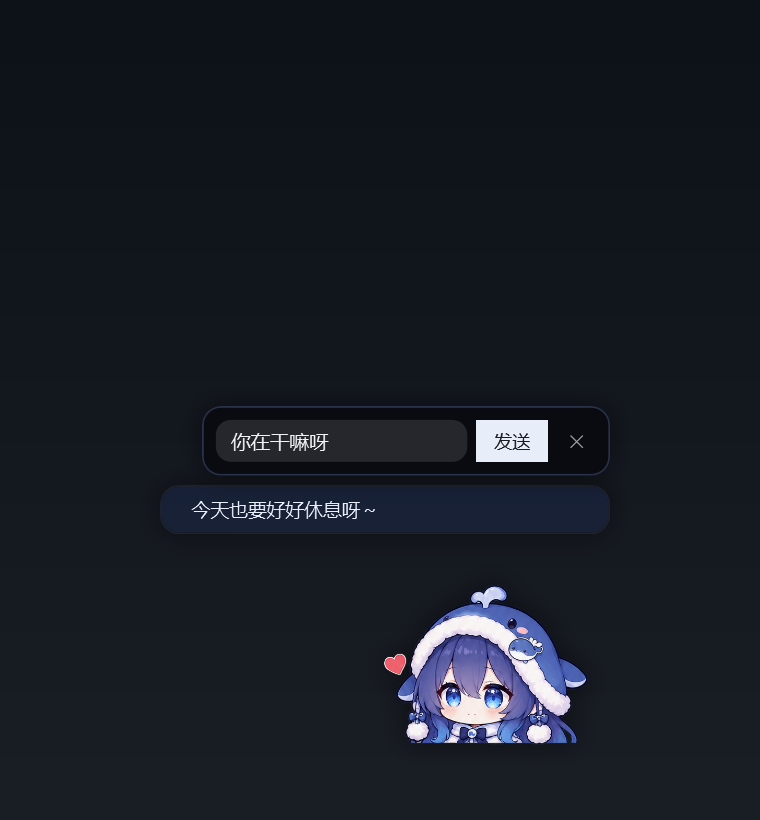
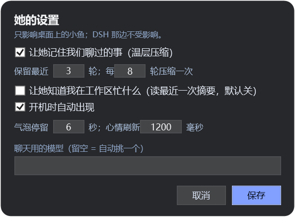
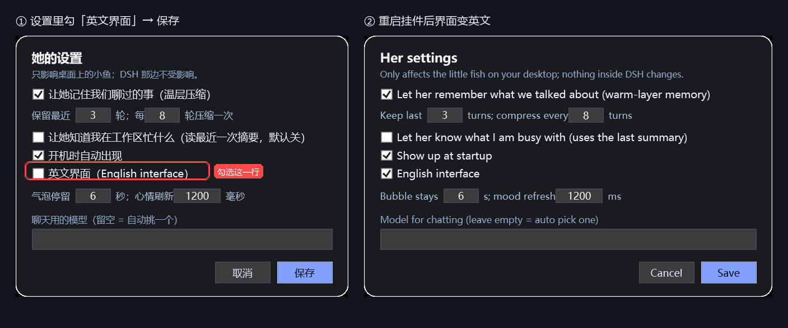

# 鱼的心情 · 桌面挂件

把「鱼的心情」从 DSH 应用窗口里搬到桌面上：一只一直待在最上层的小鲸鱼（约 156px，占桌面右下角一小块），
心情值来自 `dsh-feiyu-mood` 插件写的状态文件，跟插件同源、实时刷新。**不开 DSH 窗口也能和她说话**。

<p align="center">
  <a href="../../releases"></a>
  <a href="LICENSE"></a>
  <a href="https://github.com/topics/dsh-plugin"></a>
  <a href="https://github.com/topics/desktop-pet"></a>
  
  
</p>

如果这只小鱼让你的桌面热闹了一点，点个 ⭐ 能让更多人看到它。

<p align="center">
  
  
</p>

本仓库基于 [`dsh-feiyu-mood`](https://github.com/Yuuyuko-uu/dsh-feiyu-mood)（作者 Yuuyuko-uu，MIT）：
心情系统与角色立绘来自那个插件，这里是“把同一个她从应用窗口里拎到桌面上”的桌面端实现。
使用时请一并保留对原作者的署名，详见 [CREDITS.md](CREDITS.md)。

## 环境

- Windows 10 / 11，Windows PowerShell 5.1（系统自带）
- DSH 桌面端，且装好 `dsh-feiyu-mood` 插件（状态文件与立绘来自它）
- 想聊天就再加一个 `bridge/` 插件到同一个 profile

## 安装

不想自己装环境的话，直接去 [Releases](../../releases) 下 `dsh-feiyu-desktop-v1.0.0.zip`（就是本仓库的
`widget/` + `bridge/` 两个目录打包），解压后按下面的步骤装即可。

1. 把 `widget/` 复制到固定的位置，例如 `D:\Desktop\feiyu-desktop`；
2. 改 `bridge/cordis.patch.yml` 里的三个路径（`dir` / `widgetVbs` / `widgetPid`）指向该目录，
   然后：

   ```powershell
   dsh plugin --profile desktop add file:D:/路径/dsh-feiyu-bridge
   ```

   （或 DSH → 设置 → 插件 → 安装本地 `file:` 包）
3. 启动：双击 `launch.vbs`，或右键托盘图标 →「开机自启」。

## 操作

| 操作 | 效果 |
| --- | --- |
| 左键点一下 | 弹一下 + 弹出聊天输入条 |
| 双击 | 她随机说一句（按当前心情选台词） |
| 右键 | 菜单：面板、她的设置、和她说句话、开机自启、重启、退出 |
| 按住拖动 | 换位置（20px 内自动吸附到屏幕边缘，位置记住） |
| 托盘图标 | 随时把她叫回来 / 右键菜单 |

面板显示：心情值 + 脸（≥80 欢喜 / ≥62 开心 / ≥42 一般 / ≥25 心疼 / 其余难过）、上次判断理由、
七根情绪条（由桌面聊天本身累计，不打开 DSH 也会变化）、最近的心情记录。

## 特性

- **待机动效**：以下盘为支点呼吸（±1.6%）、左右微摆、偶尔慢速“垂眼”；点击有弹跳。
  眨眼已按要求停用：原作者没有提供与睁眼帧同构图的闭眼立绘，任何合成都会多一条上睫毛线
  （几次尝试的结论记录在 `CREDITS.md`）。
- **桌面聊天**：输入一句 → 桥插件在 DSH Host 里做一次性模型调用 → 逐字写回气泡，语气跟心情挂钩；
  点空白处收起输入条时，气泡会滑落回她头顶，不会挂在半空。
  不占你的会话上下文。
- **情绪与记忆**：持久的亲密度/信任/精力会随时间漂移；聊天有热层（最近 N 轮原话）与温层
  （每 M 轮压成几条要点），冷层日记暂不做。
- **她的设置**（右键 →「她的设置…」）：记忆开关、保留/压缩节奏、“知道我在忙什么”、开机自启、
  气泡秒数、刷新间隔、固定模型；写 `pet-settings.json`，挂件与桥插件都实时读。
  设置窗底部还会显示当前版本与构建号（`v1.0.0 · build 13 · 2026-10-27`），托盘提示里是同一串。
- **英文界面**：设置小窗里勾上「英文界面（English interface）」，面板、菜单、托盘、气泡、聊天条、待机台词
  就全切成英文；不勾就是中文。同一个开关也写在 `pet-settings.json` 的 `lang`（`auto` / `zh` / `en`）里。切换语言会自动重启挂件：旧窗口会一直留到新窗口画好，看上去几乎无缝。


- **自动左右翻转**：按她所处的屏幕左右半边自动判断——放到左半边时整个形象水平镜像，
  这样她始终“面朝屏幕里”，不会被屏幕边缘挡住脸。
- **全屏自动隐藏**：整块屏幕被全屏窗口（视频/游戏/无边框应用）盖住时自动收起，退出后回来。
- **透明区域点击穿透**：没有像素的地方点击会直接穿到下面的程序；只有画到身上才响应。
- **托盘 + 守护**：桥插件每 25 秒看一眼挂件是否在跑，被杀掉会自动拉起；退出 DSH 不会弹出“中断进程”对话框。

## 配置

`widget/pet-settings.json`：

| 键 | 说明 |
| --- | --- |
| `memory.enabled` | 记忆开关（关掉后不读不写 `bridge/memory.json`） |
| `memory.keepTurns` | 热层保留轮数（1–12） |
| `memory.compressEvery` | 每多少轮压缩一次（2–40） |
| `memory.maxPoints` / `warmPoints` | 温层要点条数 |
| `knowWorkspace` | 是否把“最近一次判断摘要”带进提示 |
| `bubbleSeconds` | 气泡默认停留秒数 |
| `refreshMs` | 读心情状态文件的间隔 |
| `autostart` | 开机自启开关 |
| `model` | 固定模型 id；留空自动挑一个 chat/flash 模型 |

## 数据与隐私

- 只读本地文件：`<DSH_HOME>/feiyu-mood/state.json`、`config.json`、`pet-settings.json`、`bridge/` 目录；
- 聊天文本只发给你在 DSH 里配置的模型服务；
- 记忆就是磁盘上的 `bridge/memory.json`，删掉即忘。

## 文件结构

```
widget/FeiyuMoodDesktop.ps1   主程序（PowerShell + WPF，透明置顶）
widget/launch.vbs             免黑框启动器
widget/assets/                feiyu.png + 五张表情
widget/pet-settings.json      她的设置
bridge/                       Cordis 插件：文件桥 + 情绪 + 记忆
docs/                         预览图
```

## 改了之后怎么同步

仓库里的 `widget/`、`bridge/` 是实际运行那份的拷贝。改完本机脚本后，用仓库自带的同步脚本把它抄回来：

```powershell
powershell -ExecutionPolicy Bypass -File scripts\sync-from-live.ps1
```

脚本会处理换行（git 里 LF、磁盘上 CRLF）并补回 PowerShell 5.1 读中文所必需的 UTF-8 BOM。
然后在 GitHub Desktop 里提交、点 **Push origin** 即可。

## 这个东西是在谁的基础上做的

先把话说清楚：**这是一个站在别人肩膀上做的项目**。

**基础：** [`dsh-feiyu-mood`](https://github.com/Yuuyuko-uu/dsh-feiyu-mood)（作者
[Yuuyuko-uu](https://github.com/Yuuyuko-uu)，MIT 许可）。从这个项目里来的：

- 角色「小鱼 / 肥鱼」和 `widget/assets/` 里的五张表情立绘；
- 那套心情模型（七种情绪、衰减、本挂件读取的状态文件）；
- “角落里住着一个小家伙”的设定。

如果要用这里的立绘或心情系统，**请一并保留对原项目的署名**——它是地基。

**本仓库新增的：** 独立的 WPF 桌面挂件（`widget/`）、让她在不开 DSH 窗口时也能聊天的文件桥插件
（`bridge/`）、情绪/关系层、热+温两层记忆压缩、设置小窗、拖到边缘吸附、全屏自动隐藏、托盘与守护、
以及把这一切打包成可分发形态。

## 欢迎在此基础上继续改

这个仓库应该被当成一个起点，而不是成品：

- **随便 fork、随便改、改成你自己的版本。** MIT 许可，不需要问；只需要保留对上游项目和原画师的署名。
- **欢迎提 Issue、提 PR。** 我们特别希望有人帮忙的方向：
  - 五张表情各自的“闭眼帧”（这也是目前眨眼功能被关掉的原因）；
  - macOS / Linux 桌面移植；
  - 冷层日记（长期记忆）；
  - 更多待机动画、摸摸/喂食互动、音效。
- **也请对原作者友好。** 如果这里的改动对上游有用，欢迎去 `dsh-feiyu-mood` 提 issue 或 PR，
  而不是只有一个静悄悄的 fork。
- 如果你改好了立绘或心情模型，也建议先贡献给 `dsh-feiyu-mood` —— 角色住在那里。

## 许可

MIT，见 [LICENSE](LICENSE)。角色与心情系统版权归原作者（`dsh-feiyu-mood`），见 [CREDITS.md](CREDITS.md)。
